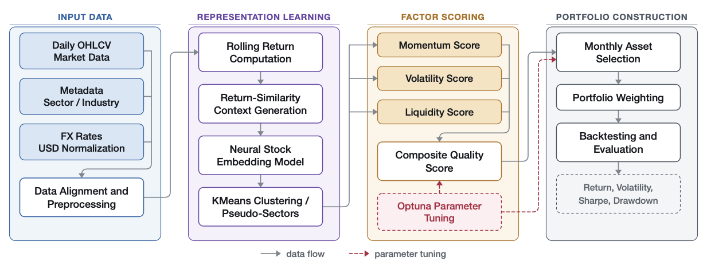
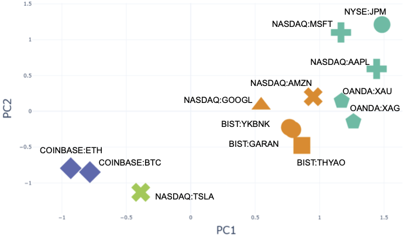
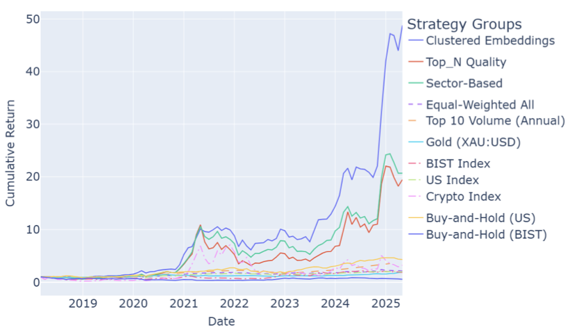

# Portfolio Optimization via Learned Stock Embeddings

Code and data for **"Learning Stock Embeddings for Multi-Asset Portfolio Optimization"** (IDEAL 2026).

Instead of forecasting individual asset prices, the pipeline learns embeddings from return similarity, clusters assets into latent sectors, ranks them within each cluster by momentum/volatility/liquidity, and tunes construction parameters with Optuna. In a sequential backtest from January 2018 to May 2025 (89 monthly rebalances) over a USD-normalized dataset of 1,093 instruments (U.S., European, Turkish, and Chinese equities, commodities, and cryptocurrencies), the clustered-embedding strategy reached **48.78x** final return, more than double the sector-based (20.66x) and Top-N quality (19.47x) strategies.

## Pipeline

Raw OHLCV data are normalized, turned into daily return contexts, embedded, clustered into latent sectors, scored with financial factors, and converted into monthly portfolios.

## Learned Embeddings vs. Static Sectors

A 2D PCA projection of one embedding checkpoint. The Turkish banks BIST:YKBNK and BIST:GARAN sit close together and far from NYSE:JPM, even though all three carry the same financial-sector label — the embeddings capture relationships static sector taxonomies miss.

## Backtest Results

| Strategy | Return | Vol. | Sharpe | MDD |
|---|---|---|---|---|
| **Clustered embeddings** | **48.78x** | 0.134 | 1.39 | -41.70% |
| Sector-based | 20.66x | 0.157 | 1.03 | -55.28% |
| Top-N quality | 19.47x | 0.177 | 0.96 | -70.90% |
| Buy-and-hold U.S. | 4.32x | 0.073 | 0.93 | -35.81% |
| Volume, annual | 3.55x | 0.309 | 0.78 | -24.52% |
| Equal-weighted | 2.16x | 0.054 | 0.66 | -22.09% |

Full results, including regional index baselines and the perfect-foresight upper bound, are in the paper.

## Data

1,093 instruments: every S&P 500 constituent, the top 50 Euronext stocks, the full BIST 100, the CSI 300, spot gold/silver, and ~130 liquid cryptocurrencies. Daily OHLCV from January 2000 onward, sourced from TradingView (prices) and Yahoo Finance (sector metadata), USD-normalized and calendar-harmonized. See the paper for full preprocessing details.

## Status

This repository currently hosts the paper's documentation and figures. **The pipeline code (embedding training, clustering, scoring, backtesting) and the processed dataset will be published here** following the camera-ready release of the paper.
